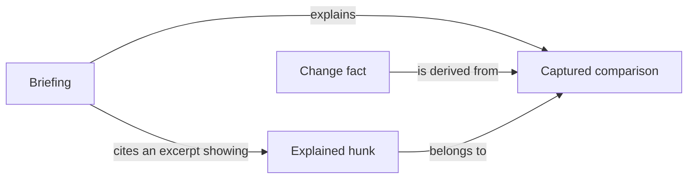

# DiffCompass

A local workspace where a person reads, questions and reviews a captured Git change with an agent's help.

## Language

**Captured comparison**:
The frozen pair of Git trees under review, a base and a head, read from Git objects rather than the working tree.
_Avoid_: diff (the rendered output), workspace.

**Briefing**:
The outcome-first reading document that explains one captured comparison through prose, cited code excerpts and diagrams, saved with the review.
_Avoid_: intro, tour briefing, summary.

**Change fact**:
A statement about a captured comparison that DiffCompass derives by parsing the code itself, never from an agent's output. Each change fact names the analysis that produced it.
_Avoid_: static analysis result, ground truth.

**Explained hunk**:
A hunk of the captured comparison whose every changed line is shown in an excerpt cited by the Briefing, including the opposite side and context the excerpt displays, and not hidden behind an omitted-lines marker. A hunk with only some changed lines shown is partly explained, and its unshown lines stay visible. Whether a hunk is explained is computed, never claimed by the agent.
_Avoid_: covered hunk, reviewed hunk (reviewing is the reader's act).

**Intent source**:
The origin of a stated reason for a change: the pull request description, its linked issue or the reviewer task. Commit messages are not an intent source. A reason with no intent source is inference.
_Avoid_: context, rationale (the rationale is the reason, not where it came from).

## Relationships

