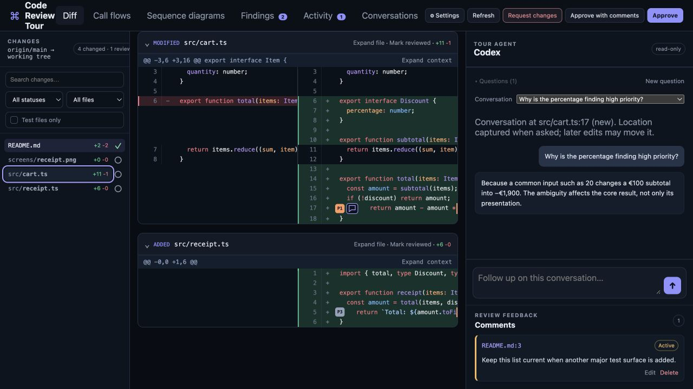
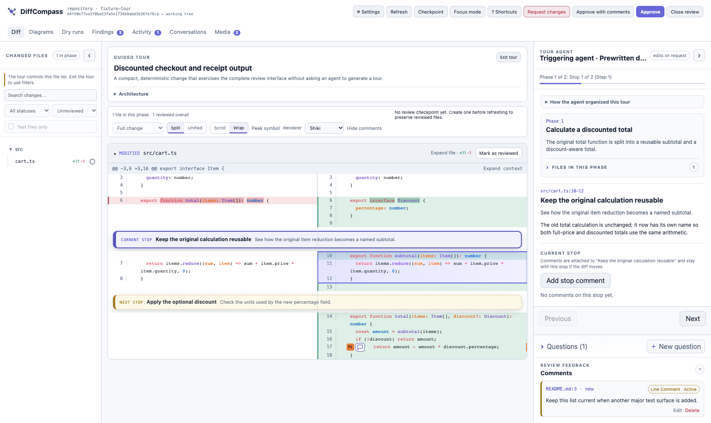

# Code Review Tour

A local, agent-led walkthrough for Git changes. Review the code, understand the
reasoning, ask questions on individual lines, and propose edits without leaving
the browser. Code Review Tour works with local changes or an isolated GitHub
pull-request checkout; applying a suggestion and publishing a GitHub review are
explicit actions.



[Install](#install) · [Run](#run) · [Questions](#questions-and-conversations) ·
[Edits](#comments-and-code-suggestions) · [Media](#images-and-videos) ·
[Development fixture](#reusable-test-fixture)

Before the tour starts, choose the attached or installed agent, its model and
reasoning level, and whether this run should include the component map, changed
call flows, sequence diagrams, and findings. All optional outputs are enabled by
default; disabling one skips that generation work.

The selected agent plans an ordered route through the change, anchors every stop
to the relevant code, and stays available for follow-up questions.



During the tour, the active stop is highlighted and summarized directly in the
diff. The agent pane shows the current phase and a short explanation, while the
file tree and code remain freely navigable. `Previous` and `Next` return the
reviewer to the ordered route without locking ordinary browsing. At the final
stop, `Finish tour` ends guided navigation without approving or closing the
review. Questions remain available, and you can resume the tour later.

## Features

- compares the merge base of a parent branch with the current working tree;
- includes committed, staged, unstaged, and untracked changes;
- identifies the active repository and branch in the persistent top bar, using pull-request metadata when reviewing an isolated GitHub PR workspace;
- renders the complete repository tree, unchanged source files, and the branch diff between independently resizable file and agent panes;
- detects installed Codex, Claude Code, Gemini CLI, and GitHub Copilot CLI agents;
- lets the reviewer choose an available agent, model, and reasoning effort, plus whether to generate the component map, call-flow changes, sequence diagrams, and findings;
- asks the selected agent to organize the change into logical phases and precise code stops;
- prepares up to five upcoming stops by default, configurable from zero to five in Settings;
- keeps line-anchored conversations in a separate Questions area and Conversations tab, with speech-bubble badges that reopen threads without changing the tour stop;
- lets reviewers remove selected code context or add up to eight repository files to a question;
- places a prominent tour annotation immediately before the active code while the agent gives a short, plain-language explanation in a separately scrollable panel;
- keeps diff navigation reviewer-controlled, with a `Current step` shortcut when you scroll away from the active stop;
- declares each phase's changed files and their role in a collapsed-on-entry section, with Git-derived additions and deletions;
- separates stop-scoped and phase-scoped P0–P3 findings, with collapsed phase summaries matching the in-code pin tooltips, selected-finding highlighting, back-to-code navigation, and a complete Findings view for global and migrated analysis;
- syntax-highlights loaded diffs locally in both light and dark themes;
- previews changed PNGs directly in the diff with Before/After images, single-sided additions/deletions, and full-size links (up to 20 MiB per image; live review only);
- traces changed caller-to-callee edges from concrete entrypoints, compares their Before and After trees, and links every added or removed call back to its diff evidence;
- renders Mermaid sequence diagrams as strict local SVG for goal-critical flows, with exact expandable affected-file lists, explicit fully traced, partly inferred, or unverified provenance wording, validated editing, source fallback, and agent regeneration;
- applies bounded repository review instructions, finding categories, and a minimum finding severity;
- validates findings in a separate repository-aware pass that traces consequential candidates through their actual runtime, build, signing, CI, and delivery consumers and performs a focused recall audit before results are shown;
- exports the complete tour, call flows, sequence diagrams, findings, reviewer feedback, changed-file state, and diff as Markdown or self-contained HTML;
- refreshes when repository files change and marks stale annotations as outdated;
- records agent-authored file changes, their triggering request, and verification in an Activity timeline;
- prepares attached-agent edits in isolated worktrees with explicit Apply, Reject, and conflict-safe Undo controls;
- persists review state atomically so the server can resume it after restart;
- provides a session library to reopen, rename, archive, and delete saved tours;
- follows the system light or dark appearance, with independent syntax palettes including GitHub, Vitesse, Review Tour, and three Catppuccin flavors;
- adapts to narrow screens with a dismissible Files drawer and Tour/Questions pane controls;
- checks for new releases without interrupting the review and shows an animated, one-click update control only when one is available;
- renders very large diffs one file at a time in bounded 1,000-row chunks;
- searches changed paths and code, filters by file or review status, and switches between a flat Git-style changed-path list and the full repository tree;
- starts with a dense split diff on desktop and unified diff on narrow screens, expands hunk context on demand, and persists per-file reviewed state;
- opens GitHub pull requests in isolated worktrees, shows their collapsible description above the diff plus metadata, checks, commits, and review threads, and publishes an explicitly confirmed review;
- exposes explicit `Approve`, `Approve with comments`, and `Request changes` decisions, with a review note for the latter two.

Standalone **agents** are read-only; reviewers can still create inline edit
suggestions. In attached mode, the triggering agent—or its local fallback after
a lost heartbeat—may edit only when the reviewer explicitly requests a concrete
change. Suggestions are prepared in isolated worktrees: the reviewed working
tree remains untouched until the reviewer presses `Apply`. Applying a suggestion
does not commit or push code.

## Attached-agent mode

Ask your agent to use the bundled [code-review-tour skill](skills/code-review-tour/SKILL.md).
It launches the page and serves the authenticated bridge while you review:

```sh
code-review-tour --attached --start-tour --open --repo /path/to/repository
```

The launching agent must keep serving bridge events; running the command alone
does not provide an attached responder. Start the server so it survives the
caller's tool timeout and process-group cleanup. The skill documents the
long-lived watcher, bounded polling alternative, and complete response shapes.
Add [media evidence](#images-and-videos) with repeatable `--media PATH` arguments.

Agents may optionally identify their current model and effort so the page starts
with matching attached-session metadata:

```sh
code-review-tour --attached --start-tour --open --repo /path/to/repository \
  --caller-model YOUR_CURRENT_MODEL \
  --caller-reasoning high
```

Both caller flags are optional and independent. They label the triggering
session; they do not start or switch to another model. If omitted, the picker
continues to show `Current agent session` and the CLI default effort.

Finding generation can be disabled for a session without adding configuration
to the reviewed repository:

```sh
code-review-tour --attached --start-tour --open --no-findings \
  --repo /path/to/repository
```

Without `--no-findings`, findings remain enabled by default. The flag is a
session-only override and does not create or modify `.code-review-tour.json`.

`--start-tour` completes the outline and first explanation before the single
user-facing page opens, so an agent-triggered launch appears ready at stop one
and never needs to drive a second browser or press the setup button. In this
mode, `--attached --open` implies `--start-tour`; omitting the explicit flag
cannot open an empty tour. A preparation failure leaves the server available
for diagnosis but does not open the browser.
In this mode, tour planning, step explanations, and reviewer questions are sent
to the triggering agent through an authenticated loopback event bridge. Future
stops are prepared concurrently within the configured prepare-ahead window (five by default), and
a reviewer question is issued immediately without waiting for that background
work. Attached-agent skills coordinate independent workers when the host supports
them; every response is committed against its own bridge event. Browser and
bridge capability tokens are separate, browser mutations require same-origin
requests, and the bridge token is passed through an owner-only temporary file.
Closing the review sends its decision, overall note, and collected line comments
back to that same agent. The
bundled skill at `skills/code-review-tour` contains the complete polling and
response workflow; Codex, Claude, Gemini, and Copilot adapters remain available as standalone
fallbacks in the picker.

Feedback events also carry the exact Git tree that was reviewed. Workflows that
apply the comments and immediately tour again pass that tree back through
`--base`, which scopes the follow-up tour to the feedback-induced changes instead
of showing the original diff a second time. `--base` therefore accepts a branch,
commit, or captured Git tree without writing review metadata into the repository.

## Install

Release archives contain self-contained macOS, Linux, and Windows executables
for Intel and ARM processors. Bun is not required after installation. Because
the repository is private, authenticate GitHub CLI once with `gh auth login`.
After that, installation on macOS, Linux, or WSL is one command:

```sh
gh api -H "Accept: application/vnd.github.raw+json" repos/rcosteira79/code-review-tour/contents/scripts/install.sh | bash
```

On Windows, run the equivalent command in PowerShell:

```powershell
& ([scriptblock]::Create((gh api -H "Accept: application/vnd.github.raw+json" repos/rcosteira79/code-review-tour/contents/scripts/install.ps1 | Out-String)))
```

Then verify the installation with `code-review-tour doctor`. Both commands use
your existing GitHub CLI authentication; no token is printed or embedded in
shell history. Cloning the repository and running `./scripts/install.sh` or
`.\scripts\install.ps1` remains supported for contributors who want to inspect
the installer first.

The installer verifies the release checksum, installs the self-contained command under
`${XDG_BIN_HOME:-~/.local/bin}`, and links the bundled skill into
`${CODEX_HOME:-~/.codex}/skills`, `~/.claude/skills`, `~/.gemini/skills`, and
`${COPILOT_HOME:-~/.copilot}/skills`. Re-run it to update to
the latest release. Override those locations with
`CODE_REVIEW_TOUR_BIN_ROOT`, `CODE_REVIEW_TOUR_INSTALL_ROOT`,
`CODE_REVIEW_TOUR_CODEX_SKILL_ROOT`, `CODE_REVIEW_TOUR_CLAUDE_SKILL_ROOT`,
`CODE_REVIEW_TOUR_GEMINI_SKILL_ROOT`, and
`CODE_REVIEW_TOUR_COPILOT_SKILL_ROOT`.

If an agent already has a real `code-review-tour` skill directory, the
installer preserves it and exits with instructions instead of overwriting user
files. Existing installer-managed symlinks are updated automatically.

For a binary-only installation that leaves every agent skill untouched, pass
`--minimal` (or `--binary-only`):

```sh
gh api -H "Accept: application/vnd.github.raw+json" repos/rcosteira79/code-review-tour/contents/scripts/install.sh | bash -s -- --minimal
```

The PowerShell installer accepts the equivalent `-Minimal` or `-BinaryOnly`
switch. It installs a small version-selecting command under
`%LOCALAPPDATA%\code-review-tour\bin`,
adds that directory to the user `PATH`, and uses explicitly marked skill copies
because Windows symlinks can require elevated privileges.

Installed releases manage their own lifecycle:

```sh
code-review-tour update
code-review-tour update --version v1.1.8
code-review-tour rollback
code-review-tour rollback --to 1.1.3
code-review-tour uninstall --dry-run
code-review-tour uninstall --yes
code-review-tour uninstall --yes --purge
```

Rollback only selects versions already present in the managed install root.
Updates preserve a minimal installation unless `--no-minimal` is explicit.
Uninstall preserves review sessions unless `--purge` is explicit, and it never
removes an unmarked skill directory or an unrelated command.

Pin a particular release by setting the version for the installer process:

```sh
gh api -H "Accept: application/vnd.github.raw+json" repos/rcosteira79/code-review-tour/contents/scripts/install.sh | CODE_REVIEW_TOUR_VERSION=v1.1.8 bash
```

Once the repository is public, this bootstrap can switch from authenticated
`gh api` to a conventional unauthenticated `curl` command.

## Run

An installed release requires Git and, for standalone mode, at least one
authenticated Codex, Claude Code, Gemini, or GitHub Copilot CLI. Attached mode
does not require a standalone agent CLI. For development from a checkout, Bun
is also required.

```sh
code-review-tour --repo /path/to/repository --base origin/main --open
```

From a development checkout, run `bun install --frozen-lockfile`, then
`bun run src/cli.ts --repo /path/to/repository --base origin/main --open`.

For a development-only command installation, run `bun install --global .` from this checkout.
This provides `code-review-tour` in Bun's global binary directory (`bun pm bin
-g`); ensure that directory is on `PATH`. Attached-agent protocol operations
use the internal `code-review-tour bridge` subcommand.
Install or symlink `skills/code-review-tour` into the agent's skill directory
to make requests such as “start a code review tour” trigger the attached flow
automatically.

The server binds only to `127.0.0.1`, chooses an available port from 47550–47599
(falling back to an OS-assigned port), and prints the tokenized review URL.
Use `--port PORT` to select one explicitly. Keep the URL private.

For a trusted preview tool that opens only the bare origin, `--preview-redirect`
redirects `/` to the tokenized `/t` page. Leave this option off otherwise: it
lets anyone who can reach the server obtain browser access. Responsive layouts
do not make the loopback server directly accessible from another device.

Codex models and reasoning levels are loaded from the installed App Server's live
`model/list` catalog. Claude Code has no model-list command, so its adapter uses
the authenticated CLI default model and exposes the installed command's effort
levels. Gemini exposes its documented `auto`, `pro`, `flash`, and `flash-lite`
routing aliases. Copilot models are read from the installed CLI's help catalog,
with `auto` as a safe fallback. Optional picker defaults can be supplied with
`--agent codex|claude|gemini|copilot`,
`--model MODEL`, and `--reasoning EFFORT`.
See the [standalone adapter contract](docs/agent-adapters.md) for discovery,
read-only execution, continuation, and output requirements.

The server prints an owner-only session-state path. Resume it after a restart:

```sh
code-review-tour --resume "/path/printed/by/the/server.json" --open
```

## Reusable test fixture

Development builds include a deterministic persisted tour outline with its first stop ready:

```bash
bun run fixture --open
```

Every run recreates the owned disposable Git repository and canonical session
under the system temporary directory. Stops after the first deliberately start
without explanations, so the configured prepare-ahead window and agent progress
UI can be tested without inheriting work from an earlier run. Preparing those
later stops invokes the selected local agent and may use tokens.

The fixture contains two phases, four stops, inline feedback, findings, a
component diagram, a sequence diagram, chat history, and an agent activity
entry, plus a tiny changed PNG for before/after preview checks. Sending a new
question invokes the selected agent; the fixture does not fake new answers.
Use `bun run fixture --prepare-only` when a test only needs fresh
repository and session files.

README screenshots are captured from a separate copy of this fixture. They
show example review content, not a live production repository.

## GitHub pull requests

To review a GitHub pull request without checking out its branch, authenticate
GitHub CLI and launch it from a matching repository checkout:

```sh
gh auth login
code-review-tour pr 106 --repo /path/to/repository --open
code-review-tour pr https://github.com/OWNER/REPOSITORY/pull/106 --repo /path/to/repository --attached --start-tour --open
```

The source checkout stays on its current branch. Code Review Tour fetches the
pull request into a persistent isolated worktree, compares the exact base and
head commits reported by GitHub, and retains that workspace for session resume.
The Pull request tab shows metadata, checks, commits, and the first 100 existing
review threads. Each local line comment can be included in or excluded from the
GitHub review. Approving or requesting changes shows a final confirmation bound
to the current head SHA; the server rechecks that SHA before publishing. A
durable hidden marker makes a retry reuse the remote review instead of submitting
a duplicate if the first response was interrupted. Remote updates apply only to
a clean isolated worktree and stale local annotations are marked outdated.

Applying a code suggestion changes only the isolated PR worktree. It does not
push to the PR branch. Publishing a review sends the selected comments and
review decision to GitHub, not the proposed code changes.

## Saved sessions

Saved tours can also be managed without handling state-file paths. Open the
`Settings → Manage sessions` dialog, or use a session's displayed short ID:

```sh
code-review-tour sessions
code-review-tour sessions --all
code-review-tour sessions resume 169dedd6 --open
code-review-tour sessions rename 169dedd6 "Push notification review"
code-review-tour sessions archive 169dedd6
code-review-tour sessions unarchive 169dedd6
code-review-tour sessions delete 169dedd6 --yes
code-review-tour sessions prune --repo . --days 30 --max 50
code-review-tour sessions prune --repo . --days 30 --max 50 --yes
```

New state files live under `${XDG_STATE_HOME:-~/.local/state}/code-review-tour/sessions`
and are written atomically. A standalone server exits after the review is
closed. An attached server waits until the triggering agent acknowledges the
terminal outcome.

## Questions and conversations

Select a code line and choose `Ask agent`, or start a `New question` in the
Questions pane. During a desktop tour, the explanation stays above Questions;
drag the divider to change their relative height. Exiting or finishing the
tour gives that space to Questions without closing the review.

Line questions leave a speech-bubble badge next to the code. Click it to reopen
the thread, even when the same file appears in a later phase. Opening a
conversation does not rewind the tour. The Conversations tab lists threads
across all phases. If the captured line has changed, its badge is not attached
to unrelated code; the conversation remains available in the list.

Before sending a new question, remove its selected line with `×`, or choose
`+ Add file` to browse and filter the repository tree. You can attach up to
eight text files, each no larger than 32,000 bytes. A thread retains its original
file selection and line context after the first message; start a new question
to use different context. Follow-ups appear after the previous answer.

## Comments and code suggestions

Select a line and choose `Comment` to compose feedback directly beneath the
code. Comments are separate from questions to the agent. Edit them inline;
deleting a comment uses an in-page confirmation rather than a browser dialog.

Choose `Edit` on a new-side diff line to enter replacement code. This creates
a reviewer suggestion, not an immediate working-tree change. The same controls
are available whether the reviewed code came from an existing branch or was
just written by an agent.

The `Activity` tab groups repository changes by reviewer edit or attached-agent request. It shows
the affected files, before/after diff totals, and the verification reported by
the agent. Select a file to preview the proposed patch, then explicitly `Apply`
or `Reject` it. Applied bundles can be undone while their captured context
still matches; overlapping later edits stop the operation instead of being
overwritten. Text, binary, added, deleted, and renamed files are retained in the
bundle. A review cannot be accepted or closed with feedback while proposals are
pending. Manual and background refreshes outside an active attached request are
not attributed to the agent.

Reviewer suggestions do not need an agent to generate the edit. Agent-authored
suggestions require attached mode or its local fallback. Neither kind commits
or pushes changes automatically.

## Completing a review

Finishing the tour and completing the review are separate actions:

| Action | Result |
| --- | --- |
| Finish tour | Leaves guided navigation; questions and the review stay open. |
| Approve | Closes the review as approved, without an overall note. Remove existing inline comments or use Approve with comments. |
| Approve with comments | Asks for an overall non-blocking note, includes inline comments, and closes as approved. |
| Request changes | Asks what must change, includes inline comments, and closes with feedback. |

Apply or reject pending suggestions before completing a review. Repository
policy can also require every changed file to be marked reviewed. In a local
attached review, the decision goes back to the launching agent. For a GitHub
PR, an additional confirmation is required before publishing the review.
After completion, the page attempts to close after a five-second countdown;
if the browser blocks it, the page remains read-only with manual-close guidance.

## Navigating the diff

The left panel searches both changed paths and changed code. Combine it with
file-status and reviewed/unreviewed filters. `Changed paths` groups changed files
under expanded folder sections. Single-child folder chains are compacted into
paths such as `.github/workflows`, while real branches remain nested. `Full
repository` includes unchanged source navigation with the same compact folder
chains. The sticky diff toolbar offers `Split / Unified` and `Scroll / Wrap`
controls; layout also remains available in Settings. Choices are remembered
separately for desktop and mobile. Switching preserves the visible source line
and any inline comment or edit draft. Scroll is the default; Wrap fits long lines
to the available width without changing their source line numbers. Unified uses
one number gutter: old numbers for deletions, new numbers otherwise, with both
references in the number's tooltip. Stronger inline backgrounds mark changed
words and punctuation within paired removed/added lines while syntax colours
remain intact. Each hunk can progressively load more surrounding
context without making the initial session snapshot unbounded. Marking a file
reviewed is stored with the session and survives server and browser restarts.

Use `Expand context` for more surrounding lines or `Expand file` for the whole
text file. Expansion and background preparation preserve your reading position.
When the current tour stop is out of view, `Current step` takes you back to it.

Paired removed/added lines that differ only in leading or trailing spaces/tabs
are labelled `whitespace only`. Dots show spaces and arrows show tabs on those
lines, in both diff layouts; copying the code retains its original whitespace.
A hunk summary counts these pairs. This describes the textual change, not its
safety: indentation and whitespace can still affect behaviour. Internal
whitespace changes (including spaces inside strings) are not classified this way.

### Appearance and narrow screens

Settings separates the application appearance (`System`, `Light`, or `Dark`)
from syntax highlighting (`GitHub`, `Vitesse`, `Review Tour`, `Catppuccin Frappé`,
`Catppuccin Macchiato`, or `Catppuccin Mocha`). It also contains the prepare-ahead
selector, file-tree mode, exports, and saved sessions. Clicking outside closes
the settings menu.

On narrow screens, the `Files` button opens the left pane as a dismissible
drawer. Diffs start in unified mode; an explicit layout choice is remembered
separately from desktop. Tabs scroll horizontally, file status and actions share
the top header row with the wrapping file path below, and the code pane fills
the space below the toolbar. The `Review` button groups Approve, Approve with
comments, and Request changes.
Inline edit/comment forms stay within the visible code pane when code scrolls
sideways. Line actions appear below the selected line with touch-sized controls;
the code pane adapts to the visible viewport when the keyboard opens.
`Tour` and `Questions` controls switch the agent pane's content rather
than squeezing both into the same small area. PNG Before/After previews stack
vertically on phone-sized screens. These are responsive browser layouts, not
a separate mobile app or a remote-access service.

## Images and videos

### PNGs changed in Git

Changed `.png` files render directly inside their diff frames. Modified and
renamed images show Before/After previews; added or deleted images show the
available side. Click a preview to open it full-size. The before image comes
from the comparison baseline and the after image from the reviewed working
tree. No `--media` argument is required for these previews.

PNG diff previews are limited to 20 MiB per image. They are available in the
live review, not in exported reports or pending-suggestion previews. Binary
changes can still be retained and applied as part of a suggestion bundle.

### Evidence supplied by the launching agent

Use repeatable `--media PATH` arguments to include screenshots or recordings
that demonstrate what the code built:

```sh
code-review-tour --attached --start-tour --open --repo /path/to/repository \
  --media /tmp/android-home.png \
  --media /tmp/ios-flow.mp4
```

The Media tab appears only when evidence was supplied. Files are copied into
the persisted session, survive resume, and never modify the reviewed repository.
Supported imports are PNG, JPEG, GIF, WebP, and MP4: up to 12 files per session,
15 MiB per image, or 100 MiB per video. Video playback depends on the browser's
support for the codecs inside the MP4; importing it does not transcode it.
The old `--screenshot` argument is no longer accepted—use `--media` for both
images and videos.

## Comparison base

Base resolution order when `--base` is omitted:

1. `branch.<current>.reviewTourBase` from local Git config;
2. `origin/HEAD`;
3. `origin/main`, `origin/master`, `main`, or `master`.

For a stacked branch, set the parent explicitly or configure it:

```sh
git config branch.my-feature.reviewTourBase parent-feature
```

## Repository defaults

Add `.code-review-tour.json` at the repository root to share review defaults:

```json
{
  "base": "origin/main",
  "agent": "codex",
  "model": "gpt-5.6",
  "reasoning": "high",
  "diff": {
    "layout": "split",
    "changedFilesOnly": true,
    "contextLines": 25
  },
  "review": {
    "requireAllFilesReviewed": true,
    "closeOutcome": "accepted"
  },
  "analysis": {
    "instructions": [
      "Treat authentication and persisted-session changes as high risk."
    ],
    "findings": {
      "enabled": true,
      "categories": ["correctness", "security", "testing"],
      "minimumSeverity": "medium"
    }
  },
  "retention": {
    "maxAgeDays": 30,
    "maxSessions": 50,
    "includeArchived": false
  }
}
```

`contextLines` accepts 3–200. `closeOutcome` accepts `accepted` or
`cancelled`. With `cancelled`, the UI shows only `Cancel review` instead of the
three approval/feedback actions. A resumed session
retains the settings it started with. For a new session, explicit CLI agent,
model, reasoning, and base flags override repository defaults, which in turn
override built-in and Git-inferred defaults. Unknown or mistyped settings fail
closed so a misspelled policy cannot silently be ignored.

`analysis.instructions` accepts at most 32 distinct instructions of up to 2,000
characters each. Finding analysis can be disabled, restricted to at most 32
distinct category names, or filtered to `low`, `medium`, `high`, or `critical`
minimum severity. The server enforces the category and severity policy on agent
output in addition to including it in the planning prompt. Repository
instructions cannot override read-only execution, evidence requirements, or the
tour response contract.

The tour start panel includes a Component diagram, Call flows, Sequence
diagrams, and Findings by default. Turning any of them off skips that analysis
instead of merely hiding its output.
When findings are enabled, broad tour planning produces candidates and a second,
authoritative audit validates their causal chain, removes unsupported guesses,
and searches high-impact boundaries for omissions. A malformed audit fails the
tour rather than presenting unvalidated findings.

## Architecture and analysis

The Call flows tab starts with a left-to-right component diagram modeled after ACE's
implementation-plan architecture view. It uses plain-language component names,
labels every relationship, and distinguishes new, touched, removed, and
external components. A Dependency changes list makes added, removed, or reversed
relationships explicit. Below it, each changed entrypoint expands into a
caller-to-callee tree. `Changes`, `Before`, and `After` make rewired calls easy
to compare, while call-site links return to the exact old or new diff line.
Only added and removed calls with changed-file evidence are accepted; dynamic
dispatch is labelled partly verified or unverified rather than presented as
certain.

Component diagrams in the review overview's Architecture section, the tour
introduction, and the Call flows tab include `Expand` to open a larger viewer,
with independent pan, zoom, and reset controls.

The Sequence diagrams tab renders the documented Mermaid sequence subset as
SVG using the locally bundled Mermaid runtime in strict mode; it never loads a CDN. The
validated source stays available in a collapsed disclosure and opens
automatically if rendering fails. Supported syntax includes participants and
actors, standard message and destruction arrows, notes, activation, autonumber,
and `alt`, `loop`, `opt`, `par`, `critical`, `break`, `rect`, and `box` blocks.
Edits are validated and bounded before persistence. Use `Regenerate` on one
sequence diagram or `Regenerate diagrams` to ask the active tour agent to
re-inspect the current diff. Call flows can likewise be regenerated individually
or as a complete set.

Guided reviews are organized as `Tour → Phases → Stops`. A phase represents one
coherent behavioral or architectural change and declares the changed files that
participate in it. A stop is an exact old/new diff anchor with a short inline
annotation and a deeper agent explanation. Previous and Next traverse the
flattened stop route across phase boundaries. `Settings → Prepare ahead` controls
the next zero to five stops (five by default); already prepared explanations
remain available when the window is reduced. While tour mode is active, the file tree and diff show all
and only the changed files declared by the current phase; moving across a phase
boundary swaps that scope. `Exit tour` restores the baseline all-changes review,
and `Resume tour` returns to the current stop. Findings shown below a stop are
limited to that exact anchor, phase findings sit with the phase overview, and
the Findings tab contains the complete set. Sessions created before v0.9 are
migrated into a legacy phase without guessing finding scope.

## Exports and retention

Use `Settings → Export` at any point—including after closure—to download
Markdown or a self-contained HTML artifact. Exports contain no scripts, remote
assets, session tokens, or repository filesystem paths.

Retention is always explicit. `sessions prune` previews its targets; add
`--yes` to delete them. `--repo PATH` loads that repository's retention
defaults and limits pruning to its sessions. CLI `--days` and `--max` override
the file. Archived sessions are preserved unless `--include-archived` (or the
matching repository setting) is enabled. `--temp-hours N` also targets stale
tool-owned temporary directories. Active sessions and live proposal/bridge
workspaces are process-locked and cannot be pruned; session files are rechecked
immediately before deletion so concurrent changes fail safely.
An expired pull-request session removes its associated worktree only when the
path is inside the tool-owned state directory and the worktree is clean.

## Verify

```sh
bun run verify
bun run build:release
```

Pushing a `v*` tag runs the full verification suite, builds all six release
archives, publishes checksums, and creates a GitHub Release. The package version
and tag must match.

## Roadmap

See [ROADMAP.md](ROADMAP.md) for shipped scope, upcoming milestones, and the
remaining gaps between the current local tool and a complete review workflow.
