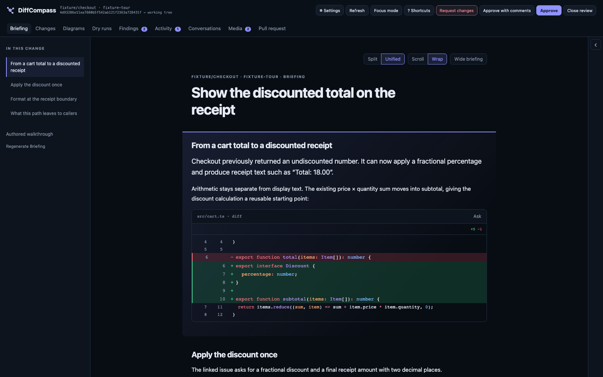
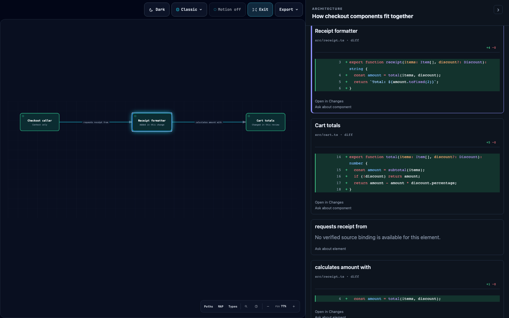

# DiffCompass

A local, agent-led review for Git changes. Start with a Briefing that explains the
outcome and connects it to the code. Explore diagrams and diffs, ask questions,
and follow a guided tour of a branch or GitHub pull request in your browser.

Pull request integration is officially supported and tested only with GitHub.
GitLab, Bitbucket, and other hosting providers have not been tested and are not
officially supported.

[Briefing](#narrative-briefing) · [Install](#install) · [Update](#update) · [Run](#run) ·
[Feature catalogue](docs/features.md) · [Development](#development)



Explore the **[feature catalogue](docs/features.md)** directly on GitHub for
features, entry points, and screenshots. Prefer the interactive version? Open the
[HTML catalogue file](docs/feature-showcase.html), click **Download raw file**,
then open the downloaded `.html` file in your browser. GitHub displays its source;
the downloaded catalogue includes its images and works offline.

## Narrative Briefing

Understand the change before walking through its files. The **Briefing** tab
starts with what becomes possible, then explains how the implementation achieves
it through prose, focused before-and-after diffs, and interactive diagrams.

- **Read with the code in view.** Source excerpts sit beside the explanation they
  support. The section outline follows your reading position.
- **Inspect a diagram.** Select a component, relationship, or sequence message to
  see its captured source evidence. **Present** expands the diagram and keeps
  that evidence beside it when you select an element.
- **Ask in context.** Attach a passage, quotation, or diagram element to a question
  without losing your place in the story.



Use **Open in Changes** to inspect the cited source and **Back to Briefing** to
return to the story. Reading and inspecting a Briefing does not advance the tour
or mark files reviewed. **Tour the code** continues into the guided walkthrough.

Briefing shares the Shiki/Monaco, Split/Unified, and Scroll/Wrap preferences with
Changes. Resize or collapse the evidence pane, choose **Wide briefing**, and
export an offline HTML reader with its diagrams and saved evidence.

See the [Briefing guide](docs/briefing.md) for saved reading state, regeneration,
source validation, mobile behavior, and export details.

*Screenshots use the disposable checkout demo with prewritten review content.*

## Install

Release binaries support macOS, Linux and Windows on Intel/AMD and ARM; Bun is not
required. The installer downloads the
[latest release](https://github.com/Mindera/diffcompass/releases/latest), verifies
its checksum, and installs the bundled skill for Codex, Claude Code, Gemini CLI and
GitHub Copilot CLI. Restart your agent afterwards so it discovers the skill.

### macOS and Linux

```sh
curl -fsSL https://github.com/Mindera/diffcompass/releases/latest/download/install.sh | bash
```

The command is installed to `~/.local/bin` by default. If that directory is not
already on your PATH, add this to your shell startup file (`~/.zshrc` or
`~/.bashrc`) and run it in your current terminal:

```sh
export PATH="$HOME/.local/bin:$PATH"
```

### Windows PowerShell

```powershell
irm https://github.com/Mindera/diffcompass/releases/latest/download/install.ps1 | iex
```

### Windows Command Prompt

```bat
powershell -c "irm https://github.com/Mindera/diffcompass/releases/latest/download/install.ps1 | iex"
```

On Windows the installer adds its command directory to your user PATH. Open a new
terminal after installation.

### Check the installation

```sh
diffcompass --version
diffcompass doctor
```

### Install a specific version or the binary only

Write the version with or without the leading `v`. On macOS and Linux:

```sh
curl -fsSL https://github.com/Mindera/diffcompass/releases/latest/download/install.sh | bash -s -- --version vX.Y.Z
curl -fsSL https://github.com/Mindera/diffcompass/releases/latest/download/install.sh | bash -s -- --minimal
```

In PowerShell:

```powershell
& ([scriptblock]::Create((irm https://github.com/Mindera/diffcompass/releases/latest/download/install.ps1))) -Version vX.Y.Z
& ([scriptblock]::Create((irm https://github.com/Mindera/diffcompass/releases/latest/download/install.ps1))) -Minimal
```

`--minimal` and `-Minimal` install the command without the agent skills. Each
release also lists `install.sh` and `install.ps1` in its `checksums.txt`, so you
can verify a downloaded script before running it.

### Requirements

| Requirement | Needed for |
| --- | --- |
| Git | Every review. |
| [GitHub CLI (`gh`)](https://cli.github.com/) | Optional. Needed only to review GitHub pull requests. |
| Codex, Claude Code, Gemini CLI or GitHub Copilot CLI | Agent-led reviews: install and sign in to one of them. |

### Install with your agent

Copy this prompt into your coding agent:

```text
Install the latest DiffCompass release on this machine.

1. Detect my OS and shell, then run the matching command:
   macOS or Linux:
   curl -fsSL https://github.com/Mindera/diffcompass/releases/latest/download/install.sh | bash
   Windows PowerShell:
   irm https://github.com/Mindera/diffcompass/releases/latest/download/install.ps1 | iex
   Windows Command Prompt:
   powershell -c "irm https://github.com/Mindera/diffcompass/releases/latest/download/install.ps1 | iex"
2. Make sure diffcompass is on PATH in this terminal and future terminals. Change
   only the shell configuration that needs it, without duplicating entries.
3. Run diffcompass --version and diffcompass doctor, and fix any setup problem
   they report. Tell me the installed version and whether I need a new terminal
   or to restart my agent to load the skill.
```

## Update

Once installed with the release installer above, run this from any directory:

```sh
diffcompass update
diffcompass --version
```

Use the lowercase command **`diffcompass`**. Updates reuse the bundled installer to
download the latest release and verify its checksum. No clone, Bun installation or
GitHub CLI is needed. Saved reviews are preserved, and binary-only installs stay
binary-only.

Installs at v2.2.4 or earlier need a signed-in GitHub CLI (`gh`) for one last
`diffcompass update`; without it, re-run the install command above, or run
`diffcompass update --version vX.Y.Z` with the latest version.

If the command is missing, check PATH or run the installer above. If a download
fails, check that this machine can reach `https://github.com`. Development installs
made with Bun should use the release installer once to get this setup.

| Task | Command |
| --- | --- |
| Install a specific release | `diffcompass update --version vX.Y.Z` |
| Return to the previously installed version | `diffcompass rollback` |
| Preview removal | `diffcompass uninstall --dry-run` |
| Uninstall and keep saved reviews | `diffcompass uninstall --yes` |

## Run

From the repository you want to review:

```sh
diffcompass --base origin/main --open
```

Use `--repo /path/to/repository` to review another checkout. The setup screen lets
you choose your agent and model. For a GitHub pull request, use its number in that
repository or its full URL:

```sh
diffcompass pr 123 --open
diffcompass pr https://github.com/OWNER/REPOSITORY/pull/123 --open
```

To use the agent you are already chatting with, ask it:

> Use the diffcompass skill to walk me through the changes in this repository.

The [bundled skill](skills/diffcompass/SKILL.md) starts the review and keeps the
agent connected for explanations and questions.


*Screenshots show the current UI with the disposable checkout demo; its sample
review content is prewritten.*

The browser runs locally on `127.0.0.1`. Keep the tokenized review URL private.
See `diffcompass --help` for launch options and the
[usage and configuration guide](docs/usage.md) for saved sessions, comparison
bases, and repository defaults.

## Development

```sh
bun install --frozen-lockfile
bun run fixture --open
bun run verify
```

See the [development guide](docs/development.md) for running from source,
browser fixtures, verification, and release builds. The [roadmap](ROADMAP.md)
tracks delivery status; [research notes](RESEARCH.md) retain detailed evidence
and historical decisions.

## License

[Sustainable Use License 1.0](LICENSE.md). Free to use and modify for your own internal business,
non-commercial or personal purposes, and to share free of charge for non-commercial purposes. You may
not sell it or offer it as a paid service, and modified copies must say they were modified.
