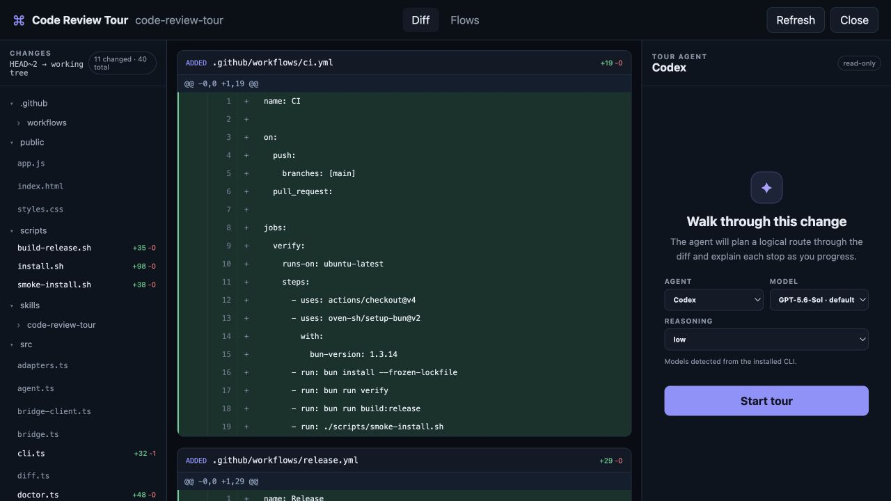
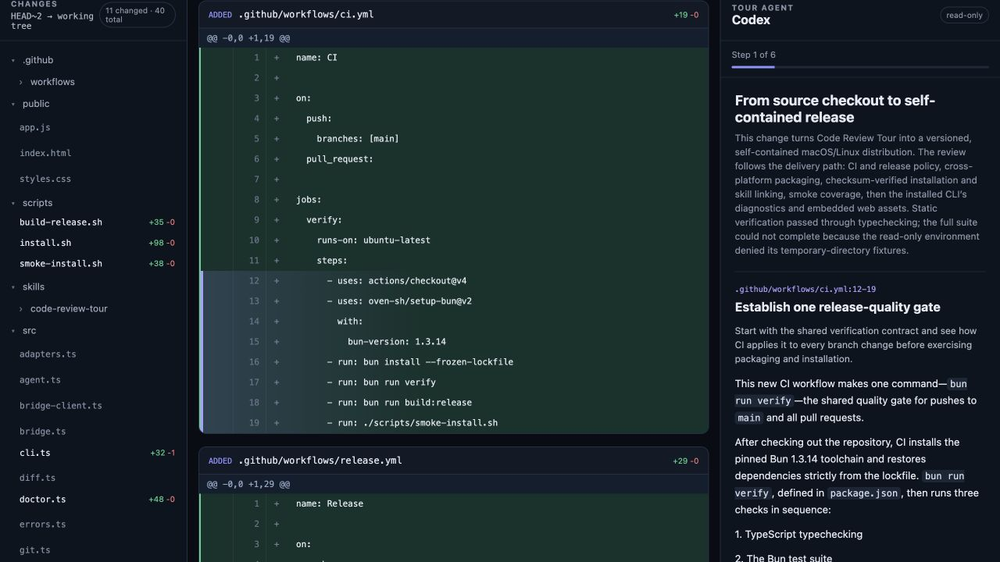

# Code Review Tour

A local, agent-led walkthrough for Git changes. The browser keeps the repository tree, full diff, ordered tour, review comments, and a resumable agent conversation in one place.



The selected agent plans an ordered route through the change, anchors every stop
to the relevant code, and stays available for follow-up questions.



## Features

- compares the merge base of a parent branch with the current working tree;
- includes committed, staged, unstaged, and untracked changes;
- renders the complete repository tree, unchanged source files, and the branch diff;
- detects installed Codex and Claude Code CLIs;
- lets the reviewer choose an available agent, model, and reasoning effort;
- asks the selected agent to create a logically ordered tour;
- generates each explanation as the reviewer moves forward;
- keeps follow-up questions in the same agent conversation;
- anchors tour stops, editable review comments, and evidence-backed P0–P3 findings to diff lines;
- generates provenance-labelled sequence views for goal-critical, high-blast flows;
- refreshes when repository files change and marks stale annotations as outdated;
- records agent-authored file changes, their triggering request, and verification in an Activity timeline;
- persists review state atomically so the server can resume it after restart;
- provides a session library to reopen, rename, archive, and delete saved tours;
- renders very large diffs one file at a time in bounded 1,000-row chunks;
- exposes `Close` and `Send feedback & close` outcomes.

Standalone Codex and Claude sessions are read-only. In attached mode, the triggering agent may edit only when the reviewer explicitly requests a concrete change; verified edits are then refreshed into the browser.

## Attached-agent mode

An agent can launch the page and remain its conversation backend:

```sh
code-review-tour --attached --open --repo /path/to/repository
```

In this mode, tour planning, step explanations, and reviewer questions are sent
to the triggering agent through an authenticated loopback event bridge. Browser
and bridge capability tokens are separate, browser mutations require same-origin
requests, and the bridge token is passed through an owner-only temporary file.
Closing with feedback emits the collected line comments back to that same agent. The
bundled skill at `skills/code-review-tour` contains the complete polling and
response workflow; Codex and Claude adapters remain available as standalone
fallbacks in the picker.

## Install

Release archives contain self-contained macOS and Linux executables for Intel
and Apple/ARM processors. Bun is not required after installation. While this
repository is private, collaborators should authenticate GitHub CLI, clone the
repository, and run the installer:

```sh
gh auth login
gh repo clone rcosteira79/code-review-tour
cd code-review-tour
./scripts/install.sh
code-review-tour doctor
```

The installer verifies the release checksum, installs commands under
`${XDG_BIN_HOME:-~/.local/bin}`, and links the bundled skill into both
`${CODEX_HOME:-~/.codex}/skills` and `~/.claude/skills`. Re-run it to update to
the latest release. Override those locations with
`CODE_REVIEW_TOUR_BIN_ROOT`, `CODE_REVIEW_TOUR_INSTALL_ROOT`,
`CODE_REVIEW_TOUR_CODEX_SKILL_ROOT`, and
`CODE_REVIEW_TOUR_CLAUDE_SKILL_ROOT`.

If either agent already has a real `code-review-tour` skill directory, the
installer preserves it and exits with instructions instead of overwriting user
files. Existing installer-managed symlinks are updated automatically.

Once the repository is public, a versioned installation needs only the checked
out installer and `CODE_REVIEW_TOUR_VERSION=vX.Y.Z ./scripts/install.sh`; GitHub
CLI is not required in that case.

## Run

An installed release requires Git and, for standalone mode, at least one
authenticated Codex or Claude Code CLI. Attached mode does not require a
standalone agent CLI. For development from a checkout, Bun is also required.

```sh
bun install
bun run start -- --repo /path/to/repository --base origin/main
```

For a development-only command installation, run `bun install --global .` from this checkout.
This provides `code-review-tour` and `code-review-tour-bridge` in Bun's global
binary directory (`bun pm bin -g`); ensure that directory is on `PATH`.
Install or symlink `skills/code-review-tour` into the agent's skill directory
to make requests such as “start a code review tour” trigger the attached flow
automatically.

The server binds to `127.0.0.1` on a random port and prints the review URL.
Codex models and reasoning levels are loaded from the installed App Server's live
`model/list` catalog. Claude Code has no model-list command, so its adapter uses
the authenticated CLI default model and exposes the installed command's effort
levels. Optional picker defaults can be supplied with `--agent codex|claude`,
`--model MODEL`, and `--reasoning EFFORT`.

The server prints an owner-only session-state path. Resume it after a restart:

```sh
code-review-tour --resume "/path/printed/by/the/server.json" --open
```

Saved tours can also be managed without handling state-file paths. Open the
`Sessions` dialog in the browser, or use a session's displayed short ID:

```sh
code-review-tour sessions
code-review-tour sessions --all
code-review-tour sessions resume 169dedd6 --open
code-review-tour sessions rename 169dedd6 "Push notification review"
code-review-tour sessions archive 169dedd6
code-review-tour sessions unarchive 169dedd6
code-review-tour sessions delete 169dedd6 --yes
```

The `Activity` tab groups repository changes by attached-agent request. It shows
the affected files, before/after diff totals, and the verification reported by
the agent after the refreshed changes are visible in the browser. Manual and
background refreshes outside an active attached request are not attributed to
the agent.

New state files live under `${XDG_STATE_HOME:-~/.local/state}/code-review-tour/sessions` and are written atomically. A standalone server exits after the browser closes the review. An attached server waits until the triggering agent acknowledges that it handled the terminal outcome.

Base resolution order when `--base` is omitted:

1. `branch.<current>.reviewTourBase` from local Git config;
2. `origin/HEAD`;
3. `origin/main`, `origin/master`, `main`, or `master`.

For a stacked branch, set the parent explicitly or configure it:

```sh
git config branch.my-feature.reviewTourBase parent-feature
```

## Verify

```sh
bun run verify
bun run build:release
```

Pushing a `v*` tag runs the full verification suite, builds all four release
archives, publishes checksums, and creates a GitHub Release. The package version
and tag must match.

## Roadmap

See [ROADMAP.md](ROADMAP.md) for shipped scope, upcoming milestones, and the
remaining gaps between the current local tool and a complete review workflow.
